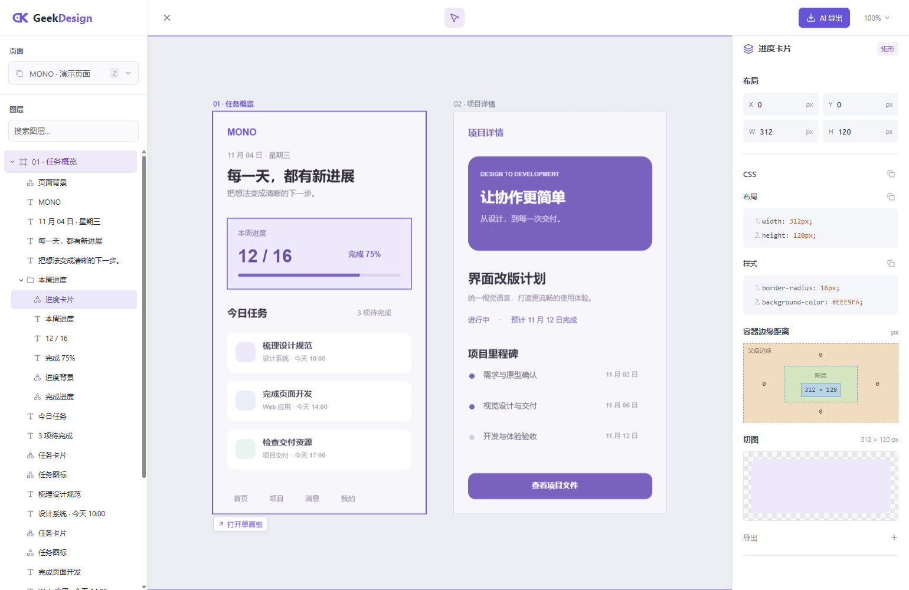

<p align="center">
  
</p>

# GeekDesign

在浏览器里打开 `.sketch` 文件：看页面、量图层、复制样式、下载切图。不必安装 Sketch，也不必把稿传到蓝湖、Pixso、MasterGo。

只看本机文件，打开网页就能用。要和同事共享稿件和字体，再自己部署一份。



## 功能

- 按原稿布局查看画板，检查图层、字体和 CSS，复制文案，Alt 测距。
- 下载原图；没有预设切图也能导出 PNG / SVG / JPG。
- 把选中画板打成 AI 交付包。
- 注册后自动获得个人空间；也可以建协作空间、邀请成员、上传字体。成员不能改别人的文件夹、覆盖别人的设计或删除别人的字体。每个设计只有当前一份稿，覆盖上传即更新。

## 怎么用

### 打开文件

https://leskur.github.io/geek-design-viewer/

选择本机 `.sketch` 即可。文件只在浏览器里处理，不会上传。

### 自建服务

打开 http://127.0.0.1:5174 注册即可。

#### Docker 部署

```sh
docker run -d --name geekdesign --restart unless-stopped -p 5174:5174 -v geekdesign-data:/app/data ghcr.io/leskur/geek-design:latest
```

局域网默认可访问，数据在卷 `geekdesign-data`。改端口把 `-p 5174:5174` 写成 `-p 8080:5174`。

更新（数据卷不要动）：

```sh
docker pull ghcr.io/leskur/geek-design:latest
docker rm -f geekdesign
docker run -d --name geekdesign --restart unless-stopped -p 5174:5174 -v geekdesign-data:/app/data ghcr.io/leskur/geek-design:latest
```

若日志出现「此数据目录已有服务运行」，是旧容器留下的锁，不是数据坏了。清掉锁再启动（不要删数据卷）：

```sh
docker rm -f geekdesign
docker run --rm -v geekdesign-data:/app/data busybox rm -f /app/data/server.lock
docker run -d --name geekdesign --restart unless-stopped -p 5174:5174 -v geekdesign-data:/app/data ghcr.io/leskur/geek-design:latest
```

卸载。只停服务、保留数据：

```sh
docker rm -f geekdesign
```

连镜像和数据一起删掉（不可恢复）：

```sh
docker rm -f geekdesign
docker rmi ghcr.io/leskur/geek-design:latest
docker volume rm geekdesign-data
```

#### 源码部署

需要 Node.js 24。

```sh
git clone https://github.com/Leskur/geek-design.git
cd geek-design
npm ci
npm run build
npm start
```

默认只监听本机，数据在 `data/`。局域网：

```sh
SKETCHPEEK_HOST=0.0.0.0 SKETCHPEEK_PUBLIC_ORIGIN=http://192.168.1.100:5174 npm start
```

把地址换成机器实际 IP。改端口设 `SKETCHPEEK_PORT`。配置用环境变量，`.env` 不会自动加载。

更新：

```sh
git pull
npm ci
npm run build
```

停掉旧进程再 `npm start`。若仍提示数据目录已有服务运行，删掉 `data/server.lock`，不要删整个 `data/`。卸载：停进程；要删数据就删 `data/`。

### 开发

克隆后：

```sh
npm ci
npm run dev
```

http://127.0.0.1:5173 是前端，后端在 5174。本地看稿走 `/local`，空间走 `/register`。

贡献前请看 [CONTRIBUTING.md](CONTRIBUTING.md)；安全问题见 [SECURITY.md](SECURITY.md)。

## 许可证

代码和项目自有文档为 [MIT License](LICENSE)。你上传的设计稿、字体和图片仍归原权利人，请确认有权使用。
