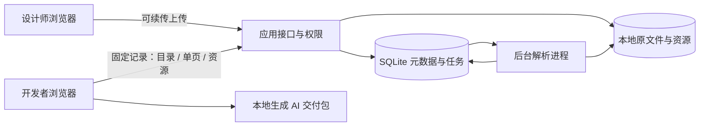

# SketchPeek 局域网团队版方案

状态：方案持续有效，第一批上传与团队查看能力已实现。日期：2026-11-01（Asia/Shanghai）。

实施进度：已完成独立账号注册、多团队与邀请链接、团队角色、项目权限、持久化上传/续传/内容复用、独立进程解析、按需查看和固定记录链接。页面总览、批量选择及 AI 交付包尚未实现。账号方案以 [账号与团队](./accounts-and-teams.md) 为准，已取消全局管理员建号。下文其余内容为完整目标范围，不能视为全部已经交付。部署见 [本地部署说明](./local-deployment.md)。

配套草图：[打开交互草图](./team-wireframes.html)。用项目本地服务访问 `/docs/team-wireframes.html`，也可以直接打开此 HTML。草图中的上传、账号、版本和下载均为演示状态。

## 1. 产品目标与第一阶段验收

设计师上传一次 Sketch，Windows 开发者通过项目链接查看，选取画板后下载 AI 交付包。

主要验收场景：设计师在 A 电脑上传 `fu-h5.sketch`，开发者在 B 电脑登录后打开链接，找到 `UI(H5)` 的 `申请开票-拒绝`，检查图层并导出画板及对应资源。上传新稿后，旧链接和旧交付包仍对应旧稿。

日常流程：

1. 成员自行注册账号；团队拥有者或管理员创建项目、生成邀请链接并分配谁可上传、谁可查看。
2. 设计师首次创建文档并上传；更新时进入原文档选择“上传新稿”。不依赖文件同名自动覆盖。
3. 上传完成后后台解析。设计师可以离开上传页面，任务仍继续。
4. 解析可查看后进入文档，复制带上传记录 ID 的链接给开发者。
5. 开发者从页面、画板列表或当前页面总览定位设计，沿用现有快捷键。
6. 开发者跨页面选择画板，导出 HTML 预览、设计数据及资源，交给 AI 实现。
7. 新稿可用时提示开发者，由开发者选择是否切换；不强制更换正在检查的稿件。

术语固定为：项目 → 文档 → 上传记录 → 页面（Page）→ 画板（Artboard）→ 图层（Layer）。“页面总览”指当前 Page 的画板总览。

## 2. 第一阶段范围

| 能力 | 第一阶段交付 | 后续扩展 |
| --- | --- | --- |
| 项目 | 创建、重命名、成员管理、文档列表 | 多组织、项目模板、归档策略 |
| 身份 | 账号注册登录；多团队与单人邀请链接；团队角色及项目成员授权 | SSO、组织目录、访客链接 |
| 上传 | 内容校验、重复文件秒传、进度、暂停/恢复、断线续传、后台处理状态 | 多文件批量上传、通知 |
| 文档 | 首次上传、上传新稿、固定记录链接、“当前稿”入口、历史上传记录 | 命名版本、视觉差异对比、完整版本管理 |
| 查看 | 复用现有渲染与检查；页面/画板导航；当前 Page 总览；空格拖动、Alt 测距 | 原型连线、评论、跨文档搜索 |
| 资源 | 原图提取、去重、资源引用表、可支持图标的 SVG 导出、显式标注不支持项 | 更完整的效果栅格化、更多格式和批量切图 |
| AI 导出 | 选画板、资源范围预检、可离线打开的 HTML、JSON 与说明、ZIP 下载 | 导出模板、框架定制、AI 平台连接 |
| 运维 | 本地数据目录、容量提示、任务重试、备份与恢复说明 | 云存储、自动备份、独立处理节点 |

第一阶段不实现在线编辑设计、实时多人协同、自动生成业务代码、原生 Sketch 级渲染保证，也不将“上传成功”等同于“可可靠交付”。

## 3. 角色与权限

角色是项目内能力，不限制成员现实中的职位；一个开发者也可被授予上传权限。

| 操作 | 项目管理者 | 设计师（可上传） | 开发者（可查看） |
| --- | --- | --- | --- |
| 查看、检查、选择画板、导出交付包 | 是 | 是 | 是 |
| 新建文档、上传新稿、重试自己的处理任务 | 是 | 是 | 否 |
| 将可用上传记录设为当前稿 | 是 | 是 | 否 |
| 下载 Sketch 原文件 | 是 | 是 | 默认否，可另行授权 |
| 管理项目成员、归档文档 | 是 | 否 | 否 |
| 管理机器、备份、创建本地账号 | 系统管理员权限 | 否 | 否 |

第一阶段链接默认要求登录和项目成员权限。文档链接不会自动赋予权限；资源、上传续传和导出接口执行相同的后端权限检查。归档与永久删除分开，初期不在日常页面提供不可恢复的历史记录清理。

## 4. 五个主要界面

### A. 项目与文档

- 左侧项目列表，中间为文档列表或卡片。
- 展示文档名称、当前稿、上传者、页面/画板数量、状态与更新时间。
- 上传按钮只对有权限的成员可用，正在处理的文档可进入查看进度。
- 尚无文档时引导首次上传；当前稿处理失败时不显示空白设计稿。

### B. 上传设计稿

- 明确此次为“新文档”或“更新已有文档”。
- 显示目标项目、目标文档、文件名、大小与可选更新说明。
- 分开显示“传输进度”和“后台处理进度”；上传阶段显示字节进度，解析阶段显示步骤，不伪造精确百分比。
- 选择文件后先显示本地内容校验进度。若当前文档已有相同稿件，显示“内容相同，无需重复上传”，直接打开已有记录，不新增重复稿件。
- 断线后显示已接收位置。刷新浏览器后可重新选择同一文件继续；不能假设浏览器仍有权限读取之前选过的本地文件。
- 上传完成后即使关闭标签页，已入队的解析仍在服务器运行。
- 失败提示具体步骤，提供“继续传输”或“重新解析”，不强迫用户重新上传已有原文件。

### C. 文档与上传记录

- 区分“当前稿入口”和“固定上传记录链接”。前者打开时解析当前指针，进入查看器后固定到具体记录。
- 展示每次上传的编号、上传者、说明、状态，以及是否为当前稿。
- 仅完整就绪的记录可设为当前稿；失败记录保留错误和重试入口。
- 当前稿仍可查看时，新上传的失败或处理中记录不影响旧稿。
- 同时上传的新稿不按完成时间盲目覆盖：完成后若当前稿已变化，标记“待确认”，由有权限的成员选择设为当前稿。

### D. 查看与检查

- 顶部始终显示项目、文档、当前上传记录；新稿提醒不自动跳转。
- 复用已完成的页面切换器、图层树、属性面板、空格拖动、Alt 测距和本地字体加载。
- “总览 / 检查”切换：总览保留当前 Page 的画板位置，只渲染视口范围；双击画板进入检查，返回恢复总览位置。
- 总览缩略图是可选加速项。第一阶段允许缺少缩略图时显示名称和画板框，不以生成高保真缩略图作为上传成功的前提。
- 跨 Page 的画板选择放入“待导出”列表；切换页面不丢失选择。
- 已知兼容问题定位到画板或图层。展示源字体名称与替代情况，避免把替代字体当作原稿字体。

### E. AI 交付导出

- 显示项目、固定上传记录、已选画板、资源数量、预计体积与兼容问题。
- 默认包含 HTML 预览、预览图、图层数据、资源对应表、所需资源及 AI 阅读说明。
- 显示“精确数据 / 近似预览 / 缺失资源”的区别；存在问题时可带问题清单导出，不能显示成“全部准确”。
- 第一阶段由浏览器按选择生成 ZIP 并下载，不要求后端具备浏览器或 macOS 渲染环境。
- 导出过程应能取消、显示步骤，失败后保留选择。处理超出浏览器可承受范围时提示缩小导出范围，而不是无响应。

## 5. 架构与读取边界

建议采用一个代码库中的模块化单体：React + TypeScript 前端，Node.js + TypeScript 后端，SQLite 元数据，本地文件存储。接口层拟用 Fastify；后端处理任务在受控工作进程中执行，不把大文件解析放在请求处理路径里。



初期可以在一台 Windows 或 Linux 主机上运行应用与处理进程；使用同一个服务入口访问前端与 API。生产运行使用构建产物和受管理的服务进程，开发环境的 Vite 服务继续用于开发。

前端读数据使用统一的 `DocumentSource` 概念，第一阶段先实现两种来源：

| 操作 | 本地文件来源 | 团队文档来源 |
| --- | --- | --- |
| 获取目录 | 读取 Sketch 压缩包元数据 | 读取固定记录 manifest |
| 获取页面 | 按需解压本地 JSON | 按需请求该页 JSON |
| 获取组件 | 本地扫描主版，保留组件索引 | 请求处理阶段生成的组件索引与主版数据 |
| 获取资源 | 本地条目转 Blob URL | 通过授权资源接口读取并缓存 |
| 关闭文档 | 回收 Blob URL、Worker 与缓存 | 取消请求，回收本地缓存 |

图层展开、几何转换、画布和导出逻辑不感知原文件位于本机还是服务器。后端复用格式解析和规范化代码；浏览器仍负责绘制。**后端上线不会自动解决当前渲染兼容问题。**

服务端一次解析出页面数据、组件索引与资源映射，开发者不需要下载整个原 Sketch。先按 Page 请求，后续在实测单页过大时再拆到画板；接口 manifest 带格式版本，不能由前端猜测存储路径。

## 6. 数据与文件存储

| 实体 | 主要内容 / 约束 |
| --- | --- |
| users / sessions | 本地成员与会话；凭据不进入导出包 |
| projects / project_members | 项目及成员能力 |
| documents | 项目、名称、当前就绪记录 ID、归档状态 |
| revisions | 文档内递增编号、原文件对象、上传说明、上传者、处理状态、解析器版本；内容不可变 |
| uploads | 上传会话、归属、预期字节数、已接收偏移、到期时间、状态 |
| jobs | 任务类型、目标记录、步骤、尝试次数、租约、错误；服务重启后可恢复 |
| objects | 内容哈希、真实 MIME、字节数、逻辑存储 key；不以用户文件名作为路径 |
| revision_assets | 原资源引用与对象哈希的映射，关联固定记录 |
| export_manifests | 在交付包内记录来源、所选画板、格式版本与问题；初期无需服务器长期保存 ZIP |

建议目录（位置由部署配置决定）：

```text
data/
  metadata.sqlite
  uploads/<upload-id>/source.partial
  objects/<hash-prefix>/<content-hash>
  revisions/<revision-id>/manifest.json
  revisions/<revision-id>/pages/<page-id>.json
  revisions/<revision-id>/symbols.json
  revisions/<revision-id>/issues.json
  staging/<job-id>/
```

`data/` 不作为公开静态目录。资源读取先验证记录归属与成员权限。对象哈希用于完整性与去重，不作为访问凭证。manifest 与所有 API 使用逻辑对象 key；后期可将对象转存云端。

SQLite 位于应用主机的本地磁盘，不放在供多台机器直接读写的共享盘。SQLite 官方说明 WAL 模式依赖同主机共享内存，不支持这种网络文件系统访问方式。[SQLite WAL 说明](https://www.sqlite.org/wal.html)

## 7. 上传与处理状态

上传状态与处理状态分别记录：

```text
上传：created → uploading ↔ paused → received → verified
                         ↘ expired / cancelled / failed

处理：queued → inspecting → extracting → indexing → ready
                          ↘ failed（可从已保存原文件重试）

发布：ready → 当前稿 / 历史稿 / 待确认
```

具体规则：

- 大文件使用流式写盘，服务器独立校验字节数与哈希，避免将整文件放入内存。即使客户端报告完成，也要经过服务端校验。
- 拟采用 tus 续传协议；服务端以已确认偏移为准，客户端恢复前查询偏移，同一会话串行写入。tus 核心协议提供查询偏移与追加上传的机制。[协议说明](https://tus.io/protocols/resumable-upload)
- 后端对路径、条目数、解压字节数和资源体积设置可配置上限。超限与文件损坏返回不同错误；具体上限在本样本和其他设计稿上实测后确定。
- 同一内容可复用对象文件；同一文档已有完全相同的原文件时返回已有记录，不新增重复稿件。不同文档仍保留各自的业务记录。不能因哈希相同而复用其他项目的访问权限。
- 解析写入 staging，完成后发布不可变 manifest，最后在数据库事务中将状态改为 ready；失败的半成品不对查看器开放。
- 任务带租约和尝试次数；进程中断后从保留的原文件安全重试，不重复创建业务记录。
- 初期限制单机并行解析数量，上传与查看请求继续可响应；并行度按机器实测配置。
- 第一次上传 ready 后成为当前稿；更新上传仅在其基于的当前稿未变化时自动推进，否则保留为待确认。

Fastify 的 multipart 插件也提供流式处理能力，但普通 multipart 上传不等于断点续传；选用 tus 后，不能再把 multipart 的整文件上传作为默认续传实现。[Fastify multipart](https://github.com/fastify/fastify-multipart)

### 7.1 内容校验与重复文件秒传

这里的“秒传”表示跳过重复的原文件网络传输；本地仍需读取和校验文件，已有解析结果不可复用时还需重新处理。界面分别显示“正在识别文件”“无需重复传输”和后续处理状态，不把所有步骤承诺为一秒完成。

识别依据为完整原文件的 SHA-256 与字节数。文件名、大小、修改时间仅可用于提示或查找续传候选，不能单独作为重复结论；Sketch 重新保存后即使画面未变，文件字节也可能不同，第一阶段不做语义级去重。

建议流程：

1. 浏览器在 Web Worker 中分段读取文件并增量计算完整内容哈希，显示进度并允许取消，不把整份 486 MiB 文件复制到主线程。
2. 向后端提交目标项目、目标文档、字节数和哈希，申请上传预检。服务端先验证上传与原文件访问权限，再在允许复用的范围内查找已经完整校验的对象。
3. 已有可复用对象时跳过原文件传输；否则创建或恢复上传会话，按断点续传流程写盘。
4. 正常接收文件后，服务端流式计算并核对完整哈希、长度与文件结构。客户端哈希不直接替代服务端校验；校验失败不发布对象或可查看稿件。
5. 关联或生成解析结果。复用键至少包含原文件哈希、解析器版本、输出格式版本与影响结果的解析选项，不能把旧版本处理结果当作新版本结果。

产品行为：

| 重复情况 | 行为 |
| --- | --- |
| 与当前文档的当前稿完全相同 | 提示“与当前稿一致”，打开已有稿，不新增记录，也不修改原稿的上传者和说明 |
| 与当前文档的历史稿完全相同 | 定位到已有历史记录；需要重新作为当前稿时走明确的设定操作，不因选择文件自动回退 |
| 当前项目中其他文档已有相同原文件，且成员有相应原文件访问权限 | 原文件免传；当前目标文档创建自己的记录，允许复用相同版本的解析产物 |
| 只有其他无权访问的项目存在相同哈希 | 不返回其存在性或内容；第一阶段仍走正常上传，接收并验证后可在内部做物理存储去重 |
| 原文件已存在，但解析失败、未完成或处理版本不同 | 显示“原文件无需传输，正在准备查看数据”；共享可复用任务或重新排队，不伪装成已经可查看 |

并发与恢复约束：

- 对象内容唯一性与文档内重复检查由服务端原子操作保证；两个相同文件同时上传不能最终产生两份相同对象或同文档重复稿件。
- 解析任务以处理键去重；业务记录、项目权限和共享存储对象保持分离。
- 已失效、被清理或仍在接收的对象不能作为秒传成功依据。预检与关联之间发生变化时应安全退回续传/上传流程。
- 可记录一次“重复上传被跳过”的操作事件，但不将该事件伪造为新设计版本。

## 8. 链接与接口草案

前端链接：

```text
/projects/<project-id>
/documents/<document-id>                       当前稿入口
/documents/<document-id>/revisions/<revision-id>
/documents/<document-id>/revisions/<revision-id>?page=<page-id>&artboard=<artboard-id>
```

接口按职责分组，路径为拟议命名，实施时再固化请求与响应契约：

| 分组 | 用途 |
| --- | --- |
| sessions / users | 注册、登录、退出、当前账号；团队成员由邀请加入 |
| projects / members | 项目与成员授权 |
| documents / revisions | 文档、上传记录、当前稿指针、任务状态与重试 |
| uploads | 内容预检与可复用检查、创建续传资源、HEAD 查询、PATCH 追加、完成校验、取消 |
| revisions/:id/manifest | 页面目录、组件索引、资源映射、解析器版本、兼容问题 |
| revisions/:id/pages/:pageId | 单页数据，携带对应记录的缓存标识 |
| revisions/:id/assets/:assetId | 授权资源读取与原图下载 |

所有读取都绑定固定 revision。只有当前稿入口需要先解析“当前”指针。打开期间发现新稿时显示提示，避免页面来自旧稿而资源来自新稿。

## 9. AI 交付包契约

```text
sketchpeek-<document>-<revision>/
  index.html
  README.md
  manifest.json
  design.json
  assets.json
  issues.json
  previews/<artboard-id>.png
  assets/<readable-name>-<short-hash>.<real-extension>
```

默认导出 ZIP，包含一个可直接打开的 HTML 入口。HTML 嵌入所需的轻量索引与查看脚本，不依赖从 `file://` 发起 fetch 读取 JSON、不依赖模块脚本、CDN或局域网服务器。独立 JSON 仍保留给 AI 使用，图片采用相对路径引用。

数据约定：

- manifest：项目/文档/固定记录 ID、所选画板、源文件哈希、解析器版本、导出格式版本和导出时间。
- design：原始图层 ID、实例路径 ID、展开后的层级、坐标、尺寸、样式、文字分段与组件关系。坐标单位为设计 px，不自动改为 rem。
- assets：每个图层/填充引用到导出资源的映射，真实 MIME、原始尺寸、文件哈希、裁剪与适配方式。跨画板使用同一资源只导出一份。
- previews：当前渲染器绘制的参考图，不宣称来自原生 Sketch；缺字体或效果近似时写入 issues。
- issues：逐项记录缺组件、缺字体、缺资源、效果不支持和导出降级；可定位到画板与图层。
- README：引导 AI 先看预览，再读结构与资源映射；结合目标项目重新实现响应式布局，不能把图层坐标直接当作最终页面布局。

资源策略：

| 类型 | 导出策略 | 不支持时 |
| --- | --- | --- |
| 位图 | 保留原始格式与字节，按真实 MIME/内容识别扩展名 | 缺失时写问题，不生成冒充原资源的文件 |
| 图标 / 矢量 | 对受支持的路径与样式生成独立 SVG，保留 viewBox | 列出不支持的效果，允许用户明确选择近似 PNG |
| 复杂组合 | 可选择当前渲染结果 PNG，并保留图层描述 | 标记近似；栅格化不会提高当前渲染器本身的还原度 |
| 字体 | 默认记录字体名称、分段样式与缺失情况 | 不自动打包开发者在本机加载的字体 |

只导出已选画板所需资源及其依赖；先预检体积与问题，再打包。文件名只用于可读性，关联以 ID / 哈希为准。画板名、图层名与文本在 HTML 中转义，资源路径不接受目录跳转。

## 10. 本地部署、备份与云端迁移

第一阶段：应用和 SQLite 在同一主机，本地磁盘保存对象与原文件；其他电脑只通过浏览器访问应用。管理员配置固定局域网地址或内网域名、同源 HTTPS 入口与数据目录，完成两台电脑连通性验收。

备份先采用可验证的维护流程：暂停新上传、停止处理并关闭数据库连接，备份整个数据目录及配置到另一块盘或另一台机器，恢复后检查当前稿、历史链接与抽样资源。后续引入数据库快照和不可变对象增量备份。运行中的 SQLite 应使用合适的数据库备份机制，而非只复制单个数据库文件。[SQLite Backup API](https://www.sqlite.org/backup.html)

存储接口预留：流式 put、流式 get、stat、删除未引用对象。业务层只保存逻辑 key，不保存 `D:\...` 或云供应商 URL。以后扩展对象存储时，逐批复制对象、核验哈希、切换读取，再处理旧文件；先不承诺同时兼容所有供应商。

扩展顺序：

1. 本地存储可用、备份可恢复。
2. 上传记录命名、状态与通知完善。
3. 视觉版本对比、评论、更多导出模板。
4. 云存储适配；数据量和并发需要时再迁移数据库或拆分处理节点。

## 11. 实施顺序与完成条件

| 阶段 | 产出 | 完成条件 |
| --- | --- | --- |
| 0. 方案评审（当前） | 本文与五屏交互草图 | 确认角色、上传/当前稿规则、交付包内容和优先级 |
| 1. 读取接口分离 | 本地来源适配、远程来源契约、共享解析模型 | 本地文件行为不退化，已有几何与交互测试通过 |
| 2. 局域网基础服务 | 登录、项目、上传、原文件保存、后台索引 | 两台电脑可访问；断线/刷新/服务重启后可恢复；权限生效 |
| 3. 团队查看 | 固定记录链接、按需读取、历史记录、当前 Page 总览 | 开发者无需请求原 Sketch；新旧稿和资源不混用；大页面可取消请求 |
| 4. AI 交付 | 选择画板、SVG 预检、位图提取、HTML/JSON/ZIP 导出 | 离线打开 HTML；图层引用无断链；包不依赖内部 API 或会话 |
| 5. 团队试用 | 测试记录、备份恢复、使用说明 | 用导出包交给 AI 实现一个真实页面，记录缺失信息并修正 |

关键验收用例：

- 486 MiB 样本：传输中断后从服务端确认位置恢复；校验完成前不进入解析。
- 同一文件改名再次提交：内容相同可跳过原文件传输；同名但内容改变的文件必须正常上传，不能误判。
- 当前文档重复提交当前稿或历史稿：返回原记录，不新增重复稿件、不悄悄切换当前稿、不改写原记录信息。
- 同一项目不同文档上传相同内容：符合权限时复用原文件，各文档记录与链接独立。
- 跨项目不可见内容：仅提供哈希不能探测或读取其他项目文件，也不能免除正常接收与校验。
- 并发相同内容：最终对象去重、同文档记录去重、处理任务可复用；故障恢复后仍保持一致。
- 解析器升级或原解析失败：可免原文件传输，仍明确显示重新处理状态。
- 服务重启：已接收上传可继续，已保存原文件的处理可重试。
- 失败新稿：原当前稿、旧链接和旧资源仍可访问。
- 并发新稿：较早开始但较晚完成的上传不会悄悄覆盖已经确认的新稿。
- 按需加载：开发者网络请求中不出现完整 Sketch 下载，只有目录、所需页面/组件/图片。
- 角色：开发者可查看与导出，无上传或成员管理权限；直接访问资源接口也受约束。
- 导出：选择两个共享图标的画板，图标只存一份，两处映射正确；字体和效果问题可定位。
- 离线：将 ZIP 移到另一台未连接服务的电脑，HTML 可打开，预览和资源可读取。
- 备份恢复：在独立数据目录恢复后，抽查原稿哈希、当前稿、固定历史链接与资源。
- 视觉：对标记过的搜索/地球图标、头像蒙版、富文本及组件覆盖回归检查；不以结构测试冒充像素级验收。

性能验收先记录主机配置、浏览器、并发人数、原文件体积、解析耗时与内存峰值，再根据试用环境制定指标；本文不把未测量的时延写成承诺。

## 12. 评审建议

草案采用以下默认选择：本地账号、项目成员登录访问、同一文档上传新稿、旧链接固定、当前稿有条件自动推进、可带问题清单导出、浏览器生成交付包。

建议先评审五屏流程是否贴合日常工作，再讨论技术细节。团队人数、部署主机配置、AI 使用工具及现有导出样本会影响后续实现参数，但不妨碍先评审流程。
